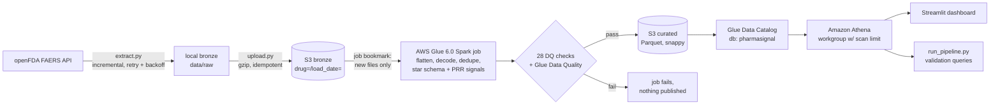

# PharmaSignal: FDA Drug-Safety ETL Pipeline on AWS

An end-to-end **ETL** pipeline that extracts real FDA adverse-event reports, transforms them with an
**AWS Glue (Spark)** job behind a hard **data-quality gate**, loads analysis-ready **Parquet** into
S3 registered in the **Glue Data Catalog**, and serves **pharmacovigilance safety signals** for MSD
brands (Keytruda, Januvia) vs their direct competitors through **Amazon Athena** and Streamlit.


## Architecture



| Stage | Where | What happens |
|---|---|---|
| **Extract** | local Python, `pipeline/extract.py` | Pulls reports per tracked drug from openFDA. **Incremental**: per-drug high-water mark (`receivedate`) in `data/_state.json`. Retries 429/5xx with exponential backoff, honours `Retry-After`, fails fast with the API's reason on 401/403. Bronze files are immutable. |
| **Stage to lake** | `pipeline/upload.py` | Gzips bronze JSON to `s3://<bucket>/bronze/drug=…/load_date=…/`. Skips keys already in S3, so re-runs upload nothing twice. Ships `reference/tracked_drugs.csv` (single source of truth for both extractor and job). |
| **Transform** | AWS Glue job `glue/jobs/transform_faers.py` + pure PySpark module `etl/` | Reads only **new** bronze files (job bookmark), merges them with the previous silver snapshot and **deduplicates on `safetyreportid`** (highest report version, then latest extraction). Decodes openFDA codes (sex, reporter, seriousness), normalises age to years, parses dates, keeps only **suspect/interacting** tracked drugs, then builds `dim_drug`, `fct_drug_reactions`, `mart_drug_safety_summary`, `mart_safety_signals`. |
| **Data quality** | `etl/quality.py` + Glue Data Quality (DQDL) | 28 checks (unique / not-null keys, accepted values, referential integrity, rates in [0,1], no future dates, reactions ≤ drug reports, no negative PRR/χ²), evaluated **before anything is written**. One failure → job fails, catalog still points at the previous good run, bookmark not committed. |
| **Load** | same Glue job | Writes Parquet (snappy) to a fresh `curated/<table>/run=<id>/` folder (fact + signals partitioned by `therapy_area`), then switches the Glue Catalog table definitions and partitions to it **directly via the Glue API** (no crawlers). Superseded runs are deleted. |
| **Orchestrate** | `pipeline/run_pipeline.py` | extract → upload → start Glue job → poll (CloudWatch log links on failure) → 3 Athena validation queries. A weekly Glue trigger exists in the template, **disabled by default**. |
| **Serve** | `dashboard/app.py` | Streamlit on Athena: KPI benchmark, signal table, quarterly trend (results cached 10 min). |
| **CI** | GitHub Actions | Every push: Java 17 + PySpark 4.1.1 (Glue 6.0's Spark) unit and DQ tests on synthetic fixtures, no network, no AWS. |

### Why this is ETL (not ELT)

The data is **transformed in flight by a dedicated compute engine (Glue Spark) before it reaches the
serving layer**. Athena only ever sees curated, typed, deduplicated, quality-checked Parquet; raw JSON
is never loaded into the query engine. Bronze stays in S3 as an immutable landing zone (expired after
90 days), and silver snapshots let the job run incrementally while still recomputing signals over all
history.

## Safety-signal method

For drug D and reaction R, compare D with its therapy-area peers (e.g. Keytruda vs Opdivo + Tecentriq):

|             | reaction R | other reactions |
|-------------|-----------:|----------------:|
| drug D      | a          | b               |
| comparators | c          | d               |

**PRR** = [a/(a+b)] / [c/(c+d)]. Flagged with the **Evans criteria**: a ≥ 3, PRR ≥ 2, χ² (Yates) ≥ 4.
Counts use distinct reports, so a report with several reactions or drugs is never double-counted.
Concomitant drugs are excluded so they can't inflate a drug's numbers (covered by a test).

> FAERS reports show association, not causation. This is a portfolio project, not for clinical use.

## Data model (Glue database `pharmasignal`)

| Table | Grain | Partitioned by |
|---|---|---|
| `dim_drug` | tracked drug (brand, company, therapy area, MSD flag) | – |
| `fct_drug_reactions` | report × suspect drug × reaction | `therapy_area` |
| `mart_drug_safety_summary` | brand: serious / death / hospitalisation / HCP-reported rates | – |
| `mart_safety_signals` | drug × reaction: a, PRR, χ², `is_signal` | `therapy_area` |

S3 layout: `bronze/` (gzipped API responses) · `silver/` (flattened + deduped snapshot) ·
`curated/` (published tables) · `reference/` · `code/` · `athena-results/` · `tmp/`.

## Cost per run (ap-south-1, on-demand list prices)

| Item | Price | Per run |
|---|---|---|
| Glue 6.0 job, G.1X × 2 workers (2 DPU), billed per second, 1-min minimum | $0.308 / DPU-hour | ≈ 2 DPU × run minutes / 60 × $0.308 → **≈ $0.03–0.08**; hard cap 15-min timeout = $0.154 |
| Athena (3 validation queries; 10 MB minimum each) | $5 / TB scanned | < $0.001 |
| S3 storage (≈ 0.2 GB bronze gz + a few MB Parquet) | $0.025 / GB-month | ≈ $0.005 / month |
| S3 requests, Glue Catalog (free tier: 1M objects / 1M requests) | – | ≈ $0 |
| Weekly trigger (disabled), CloudFormation, IAM | – | $0 |

Nothing runs between pipeline runs, so idle cost is just S3 storage.

**Measured first run (2026-11-19, full backfill of 44 bronze files / 21,247 reports):** Glue 344 s on
2 × G.1X = 689 DPU-seconds (0.19 DPU-hours) ≈ **$0.06**; all 28 assertions and all Glue Data Quality
rules passed; 3 Athena validation queries finished in 7.7 s.

| Table | Rows |
|---|---:|
| `dim_drug` | 6 |
| `fct_drug_reactions` | 50,616 |
| `mart_drug_safety_summary` | 6 |
| `mart_safety_signals` | 6,571 (383 flagged) |

Top Keytruda signals vs Opdivo + Tecentriq: ECG QT prolonged (PRR 54.9), incorrect dose administered
(37.9), dysaesthesia (28.4), bicytopenia (26.5), product use issue (23.9). Raw reports become 20,979
after deduplicating on `safetyreportid`. Januvia shows 937 of 4,331 extracted sitagliptin reports: 3,030
list it only as a concomitant drug and 364 are the sitagliptin + metformin combination (Janumet, a
different generic name), so both are excluded by design.

## Deploy, run, tear down

Prerequisites: Python 3.12+, Java 17 (for local tests only), AWS CLI v2 logged in (`aws login` or
`aws configure`), region `ap-south-1`.

```powershell
python -m venv .venv; .\.venv\Scripts\Activate.ps1
pip install -r requirements.txt
python -m pytest -v                                   # local Spark tests, no AWS

.\scripts\deploy.ps1 -BucketName <your-unique-bucket>  # CloudFormation stack + job code
python -m pipeline.run_pipeline                       # extract -> upload -> Glue -> Athena checks
python -m pipeline.run_pipeline --skip-extract        # reuse local bronze, no openFDA calls
streamlit run dashboard/app.py

.\scripts\teardown.ps1                                # empties the bucket, deletes the stack
```

No API key is needed for openFDA: it rejects 1000-row pages without a key, so keyless runs fetch 500
rows per page. Set `OPENFDA_API_KEY` (free at open.fda.gov) for full pages and a higher daily quota.
To track more drugs, add a row to `reference/tracked_drugs.csv` and redeploy. Enable the weekly
Glue trigger with `aws glue start-trigger --name pharmasignal-weekly`.

## Example Athena queries

```sql
-- Top Keytruda signals vs Opdivo + Tecentriq
select reaction_pt, reports_with_reaction, prr, chi_square
from pharmasignal.mart_safety_signals
where generic_name = 'PEMBROLIZUMAB' and is_signal
order by prr desc limit 10;

-- Brand benchmark within a therapy area
select brand_name, company, total_reports, serious_rate, death_rate, hcp_reported_rate
from pharmasignal.mart_drug_safety_summary
where therapy_area = 'Diabetes' order by total_reports desc;

-- Quarterly report volume (partition pruning on therapy_area)
select received_quarter, generic_name, count(distinct report_id) as reports
from pharmasignal.fct_drug_reactions
where therapy_area = 'Oncology'
group by 1, 2 order by 1, 2;
```

## Tech stack

Python · REST API ingestion · AWS Glue 6.0 (PySpark 4.1) · Glue Data Quality · Glue Data Catalog ·
Amazon S3 · Amazon Athena · AWS CloudFormation · boto3 · pytest · GitHub Actions · Streamlit
