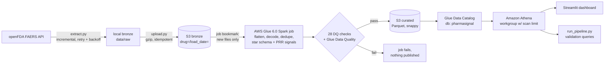

# PharmaSignal: FDA Drug-Safety ETL Pipeline on AWS

[](https://github.com/HindzStark/pharmasignal/actions/workflows/ci.yml)

-orange)


An end-to-end **ETL** pipeline that extracts real FDA adverse-event reports, transforms them with an
**AWS Glue (PySpark)** job behind a hard **data-quality gate**, loads analysis-ready **Parquet** into
S3 registered in the **Glue Data Catalog**, and serves **pharmacovigilance safety signals** through
**Amazon Athena** and a Streamlit dashboard. It benchmarks MSD brands (Keytruda, Januvia) against
their direct competitors.

## Results (first production run, 19 Nov 2026)

| | |
|---|---|
| Reports extracted from openFDA | **21,247** (44 files, 821 MB raw JSON) |
| Unique reports after deduplication | **20,979** |
| Fact rows (report × drug × reaction) | **50,616** |
| Drug-reaction pairs scored | **6,571**, of which **383** flagged as signals |
| Data-quality checks | **28/28 passed** + all Glue Data Quality rules passed |
| Glue run | **344 s** on 2 × G.1X = 689 DPU-seconds ≈ **$0.06** |
| Athena validation (3 queries) | 7.7 s |

**Top Keytruda signals vs Opdivo + Tecentriq**

| Reaction (MedDRA PT) | Reports | PRR | χ² |
|---|---:|---:|---:|
| Electrocardiogram QT prolonged | 29 | 54.9 | 48.6 |
| Incorrect dose administered | 20 | 37.9 | 31.6 |
| Dysaesthesia | 15 | 28.4 | 22.3 |
| Bicytopenia | 14 | 26.5 | 20.4 |
| Product use issue | 101 | 23.9 | 161.5 |

> FAERS reports show association, not causation. This is a portfolio project, not for clinical use.

## Architecture



| Stage | Where | What happens |
|---|---|---|
| **Extract** | `pipeline/extract.py` (local) | Pulls reports per tracked drug from openFDA. **Incremental**: a per-drug high-water mark (`receivedate`) means later runs fetch only newer reports. Retries 429/5xx with exponential backoff and honours `Retry-After`; fails fast with the API's reason on 401/403. Bronze files are immutable. |
| **Stage** | `pipeline/upload.py` | Gzips bronze JSON to `s3://<bucket>/bronze/drug=…/load_date=…/`, skipping keys already in S3, and ships `reference/tracked_drugs.csv`, the single source of truth for both the extractor and the job. |
| **Transform** | `glue/jobs/transform_faers.py` + `etl/transforms.py` | Reads only **new** bronze files (job bookmark), merges them with the previous silver snapshot and **deduplicates on `safetyreportid`** (highest report version, then latest extraction). Decodes openFDA codes, normalises age to years, parses dates, keeps only **suspect/interacting** tracked drugs, and builds the star schema and signal marts. |
| **Quality gate** | `etl/quality.py` + Glue Data Quality | 28 checks run **before anything is written**: keys, accepted values, referential integrity, rates in [0,1], no future dates, reactions ≤ drug reports, no negative PRR/χ². One failure means the job fails, the catalog keeps serving the last good run, and the bookmark is not advanced. |
| **Load** | same job + `etl/catalog.py` | Writes snappy Parquet to a fresh `curated/<table>/run=<id>/` folder (partitioned by `therapy_area` where useful), then repoints the Glue Catalog tables and partitions **through the Glue API** (no crawlers) and deletes superseded runs. |
| **Orchestrate** | `pipeline/run_pipeline.py` | extract → upload → start Glue job → poll (CloudWatch log links on failure) → Athena validation queries. A weekly Glue trigger exists in the template, **disabled by default**. |
| **Serve** | `dashboard/app.py` | Streamlit on Athena: KPI benchmark, signal table and quarterly trend, cached for 10 minutes so browsing doesn't re-scan S3. |

### Why this is ETL, not ELT

Data is **transformed in flight by a dedicated compute engine (Glue Spark) before it reaches the
serving layer**. Athena only ever sees curated, typed, deduplicated, quality-checked Parquet; raw JSON
never enters the query engine. Bronze stays in S3 as an immutable landing zone (expired after 90
days), and silver snapshots let the job load incrementally while still recomputing signals over the
full history.

## Safety-signal method

For drug D and reaction R, D is compared with its therapy-area peers (e.g. Keytruda vs Opdivo + Tecentriq):

|             | reaction R | other reactions |
|-------------|-----------:|----------------:|
| drug D      | a          | b               |
| comparators | c          | d               |

**PRR** = [a/(a+b)] / [c/(c+d)]. A pair is flagged using the **Evans criteria**: a ≥ 3, PRR ≥ 2 and
χ² (Yates-corrected) ≥ 4. Counts use distinct reports, so a report with several reactions or drugs is
never double-counted. Concomitant drugs are excluded so they can't inflate a drug's numbers (covered
by a test).

## Data model (Glue database `pharmasignal`)

| Table | Grain | Partitioned by |
|---|---|---|
| `dim_drug` | tracked drug: brand, company, therapy area, MSD flag | – |
| `fct_drug_reactions` | report × suspect drug × reaction | `therapy_area` |
| `mart_drug_safety_summary` | brand: serious, death, hospitalisation and HCP-reported rates | – |
| `mart_safety_signals` | drug × reaction: a, PRR, χ², `is_signal` | `therapy_area` |

S3 layout: `bronze/` (gzipped API responses) · `silver/` (flattened, deduplicated snapshot) ·
`curated/` (published tables) · `reference/` · `code/` · `athena-results/` · `tmp/`.

## Project structure

```
pipeline/            local side: extract.py, upload.py, run_pipeline.py (orchestrator), aws.py, config.py
etl/                 pure PySpark, no AWS imports: transforms.py, quality.py (28 checks + DQDL), catalog.py
glue/jobs/           transform_faers.py: the Glue entry point (bookmarks, DQ gate, Parquet, Catalog)
infra/template.yaml  CloudFormation: S3, IAM, Glue database/job/trigger, Athena workgroup
scripts/             deploy.ps1, teardown.ps1
dashboard/app.py     Streamlit on Athena
reference/           tracked_drugs.csv (drug list, single source of truth)
tests/               12 tests on a local SparkSession with synthetic fixtures (no network, no AWS)
```

## Run it

**Prerequisites:** Python 3.12+, AWS CLI v2 signed in (`aws login` or `aws configure`). Region `ap-south-1`.

```powershell
python -m venv .venv; .\.venv\Scripts\Activate.ps1
pip install -r requirements.txt

.\scripts\deploy.ps1 -BucketName <your-unique-bucket>  # CloudFormation stack + job code
python -m pipeline.run_pipeline                       # extract -> upload -> Glue -> Athena checks
python -m pipeline.run_pipeline --skip-extract        # reuse local bronze, no openFDA calls
python -m pipeline.run_pipeline --validate-only       # just the Athena validation queries
streamlit run dashboard/app.py

.\scripts\teardown.ps1                                # empties the bucket, deletes the stack
```

**Tests** need Java 17 and run on Linux/macOS or in CI: `python -m pytest -v`. On Windows, Spark
cannot read local files without extra Hadoop native binaries, so the suite runs in GitHub Actions.

No openFDA API key is needed. openFDA rejects 1000-row pages without a key, so keyless runs fetch
500 rows per page; set `OPENFDA_API_KEY` (free at open.fda.gov) for full pages and a higher daily
quota. To track more drugs, add a row to `reference/tracked_drugs.csv` and redeploy. Enable the
weekly schedule with `aws glue start-trigger --name pharmasignal-weekly`.

## Cost (ap-south-1 on-demand list prices)

| Item | Price | Per run |
|---|---|---|
| Glue 6.0 job, G.1X × 2 workers, per-second billing, 1-min minimum | $0.308 / DPU-hour | measured **$0.06**; 15-min timeout caps it at $0.154 |
| Athena (3 validation queries, 10 MB minimum each) | $5 / TB scanned | < $0.001 |
| S3 storage (≈ 0.27 GB) | $0.025 / GB-month | ≈ $0.007 / month |
| Glue Catalog, CloudFormation, IAM, disabled trigger | – | ≈ $0 (free tier) |

Nothing runs between pipeline runs, so idle cost is S3 storage only.

## Example Athena queries

```sql
-- Top Keytruda signals vs Opdivo + Tecentriq
select reaction_pt, reports_with_reaction, prr, chi_square
from pharmasignal.mart_safety_signals
where generic_name = 'PEMBROLIZUMAB' and is_signal
order by prr desc limit 10;

-- Brand benchmark within a therapy area
select brand_name, company, total_reports, serious_rate, death_rate, hcp_reported_rate
from pharmasignal.mart_drug_safety_summary
where therapy_area = 'Diabetes' order by total_reports desc;

-- Quarterly report volume (partition pruning on therapy_area)
select received_quarter, generic_name, count(distinct report_id) as reports
from pharmasignal.fct_drug_reactions
where therapy_area = 'Oncology'
group by 1, 2 order by 1, 2;
```

## Design decisions and lessons

- **Live-API breakage handled at the source.** openFDA began returning `403 API_KEY_MISSING` for
  `limit=1000` without a key. Keyless runs now page at 500 rows, an optional key restores 1000, and a
  401/403 fails immediately with the API's own message instead of being retried.
- **Explicit schemas over inference.** Each report is ~30 KB, mostly openFDA enrichment. Reading
  only the needed fields avoids inference over hundreds of MB and keeps types stable;
  `conform_bronze` maps Glue's inferred DynamicFrame schema onto the same contract.
- **Spark 4 ANSI mode.** Glue 6.0 enables ANSI SQL by default, so a bad cast would fail the job. All
  parsing of dirty source fields uses `try_cast`, `try_to_timestamp` and `try_element_at`.
- **Publish only what passed.** Output goes to a new run folder and the catalog is switched only
  after every check passes, so Athena never sees a half-written or failed run.
- **Testable without the cloud.** All business logic lives in `etl/`, which has no AWS imports and is
  covered by local Spark tests in CI. The Glue script is a thin I/O wrapper around it.

## Limitations

- **Uneven date coverage on the first backfill.** Extraction is capped at 5,000 reports per drug per
  run, so high-volume drugs cover a shorter window for now: Keytruda Jul–Oct 2025, Opdivo to Mar 2026,
  Tecentriq to Jul 2026, diabetes drugs to Sep 2026. Each incremental run moves the windows forward;
  treat head-to-head oncology comparisons as indicative until they align.
- **Peer comparator, not all of FAERS.** PRR is computed against tracked peers in the same therapy
  area. It's a head-to-head view, not a full-database disproportionality analysis.
- **Exact generic-name match.** Combination products (e.g. sitagliptin + metformin, Janumet) are not
  counted as Januvia. That's 364 of the 4,331 sitagliptin reports; another 3,030 list sitagliptin only
  as a concomitant drug, leaving 937 suspect reports.

## Roadmap

- Orchestrate extract + Glue + validation in Step Functions or Amazon MWAA (Airflow)
- Move curated tables to Apache Iceberg for ACID updates and time travel
- Join CMS Medicare Part D prescribing volume to normalise signals by exposure
- Natural-language Q&A over the marts

## Tech stack

Python · REST API ingestion · AWS Glue 6.0 (PySpark 4.1) · Glue Data Quality · Glue Data Catalog ·
Amazon S3 · Amazon Athena · AWS CloudFormation · boto3 · pytest · GitHub Actions · Streamlit
